<h1 align="center">
  <a href="https://vibex.peatboy.com/"></a>
</h1>

<p align="center">
  <a href="https://github.com/vibex-ai/vibex"></a>
  <a href="LICENSE"></a>
  
  
  
  
  <a href="https://deepwiki.com/vibex-ai/vibex"></a>
</p>

<p align="center">
  <a href="README.md">English</a> &nbsp;|&nbsp;
  <a href="README.zh-CN.md">简体中文</a>
</p>

<p align="center">
  <strong>Your agents. Your workspace. Your control — from prompt to commit, desktop to terminal to phone.</strong><br />
  A native, local-first AI coding workbench built on the Agent Client Protocol.
</p>

<p align="center">
  <a href="https://vibex.peatboy.com/">Website</a> &nbsp;&bull;&nbsp;
  <a href="https://vibex.peatboy.com/docs">Docs</a> &nbsp;&bull;&nbsp;
  <a href="#quick-start">Quick start</a> &nbsp;&bull;&nbsp;
  <a href="#features">Features</a> &nbsp;&bull;&nbsp;
  <a href="#supported-agents">Supported agents</a> &nbsp;&bull;&nbsp;
  <a href="#surfaces">Surfaces</a> &nbsp;&bull;&nbsp;
  <a href="#development">Development</a>
</p>

<p align="center">
  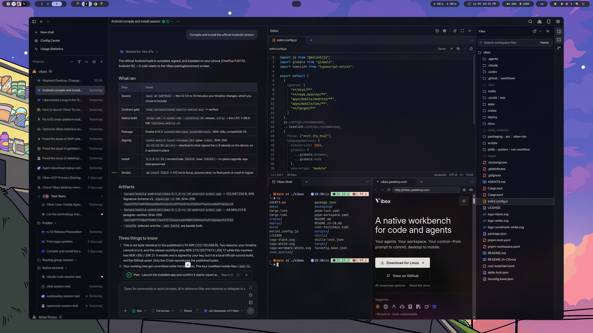
</p>

Vibex brings Agent sessions, source code, Git, terminals, an embedded browser, desktop automation, and provider configuration into one focused workbench. The desktop runtime stays in control of Agent processes, session history, workspace files, Git, PTYs, providers, and permissions. A native mobile client and a terminal client let you monitor and steer those same sessions remotely, while an optional self-hosted Relay carries only encrypted frames.

No Vibex-hosted workspace is required. Your repository, credentials, and durable session state remain on the machines you choose.

## Features

<table>
<tr>
<td width="50%" valign="middle">

### Every Agent, one workbench

Run Claude Code, Codex, ZCode, OpenCode, and any ACP-compatible Agent side by side. Vibex installs, updates, authenticates, and scopes each runtime, then keeps every session in the same timeline. You can create Agent sessions in Vibex in GUI or TUI mode, whichever you prefer.

[Docs →](https://vibex.peatboy.com/docs/agents-and-providers)

</td>
<td width="50%">
  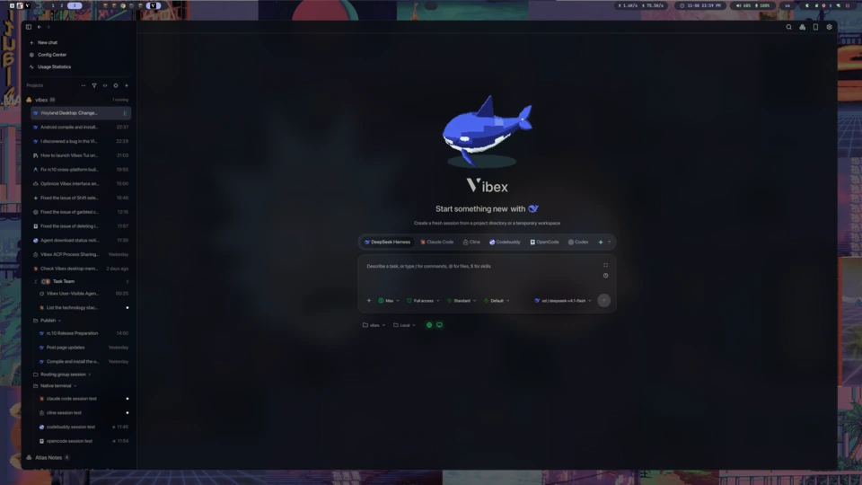<br />
  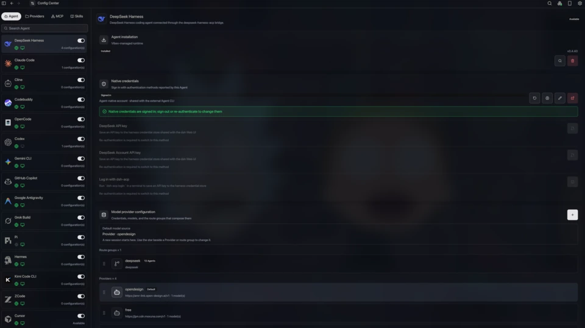
</td>
</tr>
<tr>
<td width="50%" valign="middle">

### Agent teams and goals

The main Agent can delegate work to child Agents on its own, or hand a task to a specific child Agent at the right moment under your guidance. Any Agent Harness that Vibex supports can be a delegation target, which makes cross-Agent delegation possible.

[Docs →](https://vibex.peatboy.com/docs/sessions)

</td>
<td width="50%">
  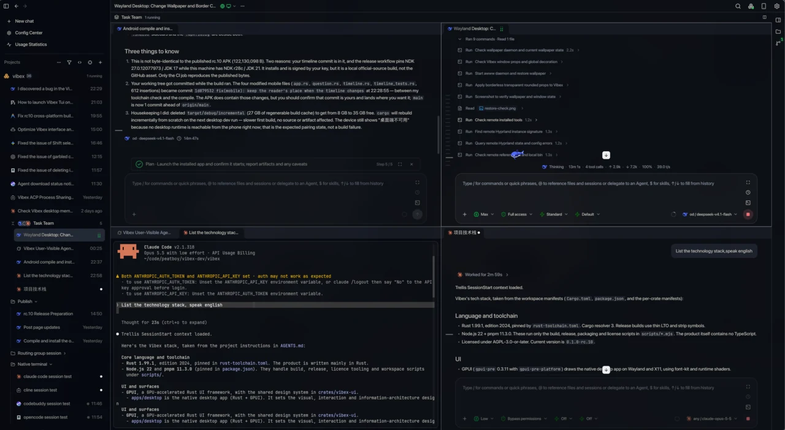
</td>
</tr>
<tr>
<td width="50%" valign="middle">

### Parallel worktrees and Git review

Every session can have its own worktree, so concurrent Agents never get in each other's way. Vibex also ships the everyday Changes and Commits workflow, so you can see what an Agent changed in real time at a glance.

[Docs →](https://vibex.peatboy.com/docs/git)

</td>
<td width="50%">
  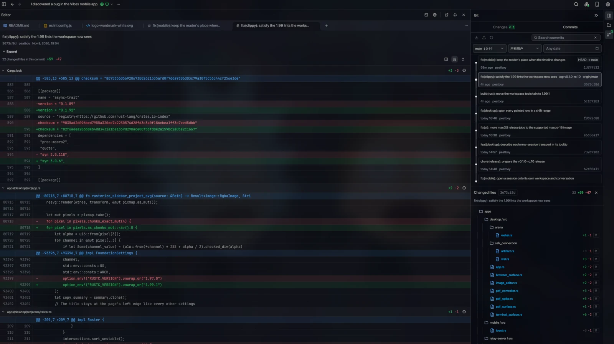
</td>
</tr>
<tr>
<td width="50%" valign="middle">

### Shared Providers and a local gateway

Configure a model Provider once and share it across Agents. A route group can hold several model Providers at once, fail over between Providers or models, and translate between OpenAI Chat, OpenAI Responses, Anthropic Messages, and Gemini — so an Agent that only speaks its own protocol can still reach models from other protocols.

[Docs →](https://vibex.peatboy.com/docs/providers-and-gateway)

</td>
<td width="50%">
  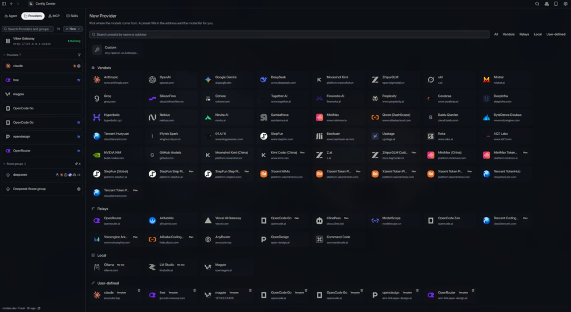<br />
  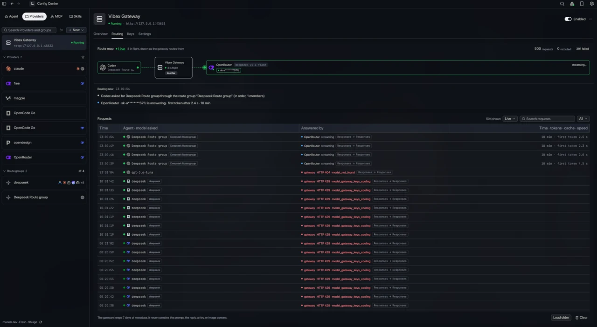
</td>
</tr>
<tr>
<td width="50%" valign="middle">

### Terminal, browser, and computer use

The Vibex editor can hold files, the terminal, and the browser at once for reading and editing. Agents can also drive the Vibex browser to browse the web, and computer use lets them control the machine — while you watch, approve, and stop them from a dedicated panel.

[Docs →](https://vibex.peatboy.com/docs/browser)

</td>
<td width="50%">
  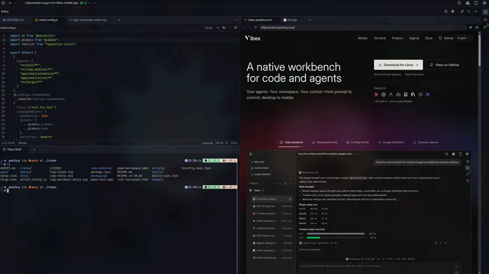
</td>
</tr>
<tr>
<td width="50%" valign="middle">

### Your phone, same session

Pair an Android or iOS client (neither is on the app stores yet) with the desktop or a remote instance. Read the same timeline, answer approvals and questions, send follow-ups, browse files and diffs, and use the terminal — vibe coding from anywhere.

[Docs →](https://vibex.peatboy.com/docs/remote-mobile)

</td>
<td width="50%">
  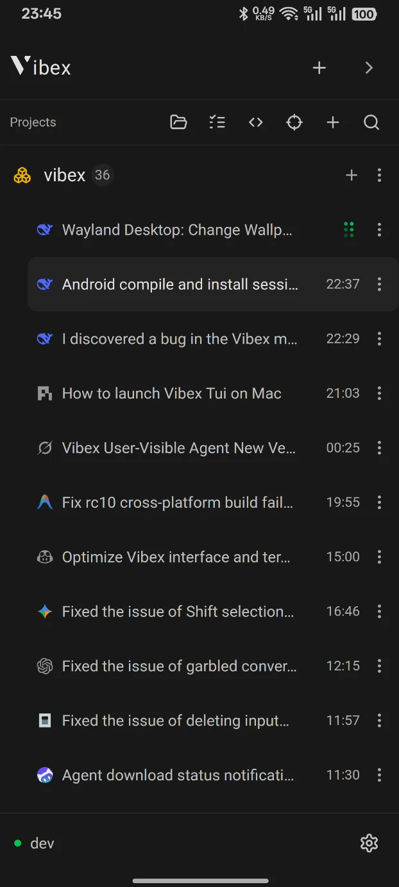 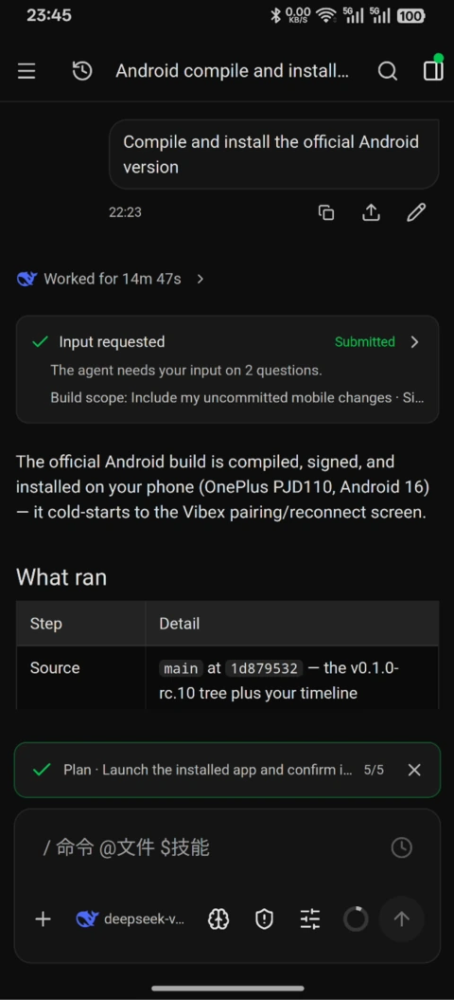 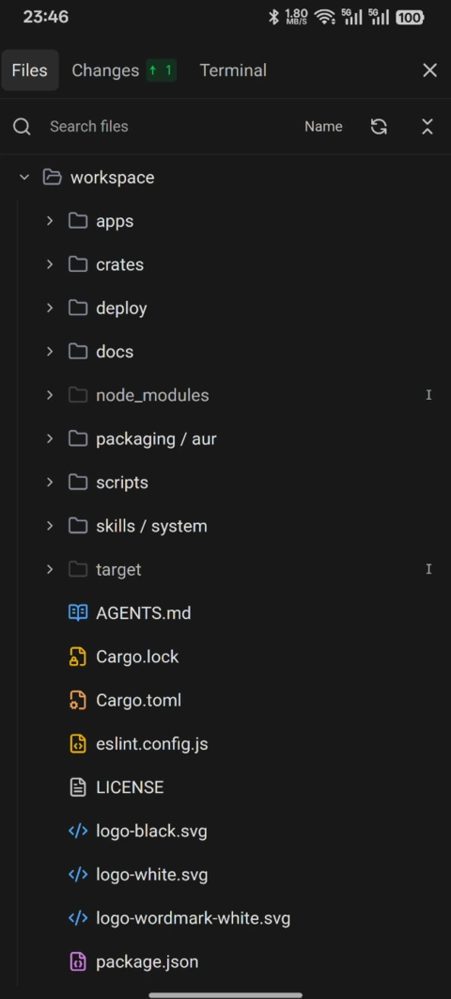
</td>
</tr>
<tr>
<td width="50%" valign="middle">

### Vibex TUI

The whole workbench in a terminal: sessions, streaming Markdown, approvals, the queue, settings, and pairing. It ships inside every desktop package, works over SSH and tmux, and can attach to the desktop runtime already running on your machine.

[Docs →](https://vibex.peatboy.com/docs/tui)

</td>
<td width="50%">
  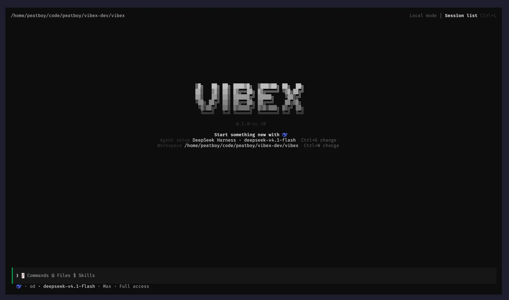<br />
  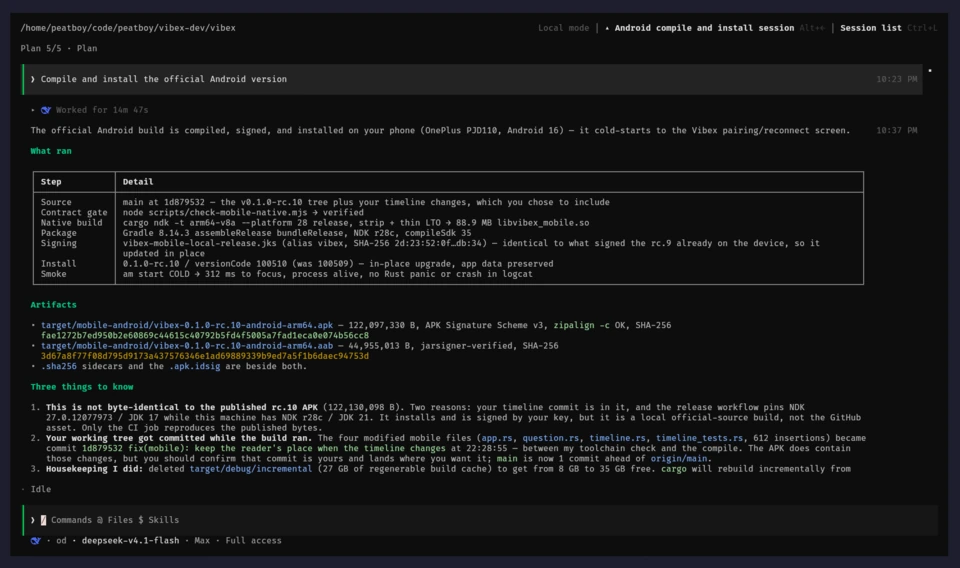
</td>
</tr>
<tr>
<td width="50%" valign="middle">

### Remote runtimes, your rules

Run Vibex as a remote instance on another machine over SSH or inside WSL2, or self-host `vibex-server` behind HTTPS, a Tailnet, or your own Relay. The desktop, phone, and TUI stay clients; the remote instance serves everything.

[Docs →](https://vibex.peatboy.com/docs/ssh-runtime)

</td>
<td width="50%">
  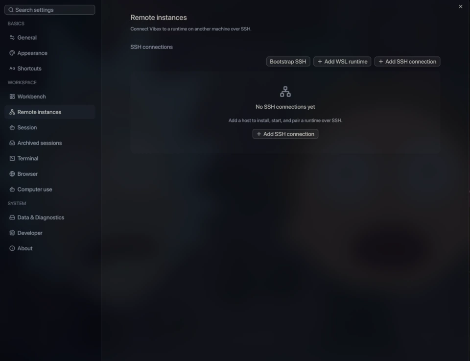
</td>
</tr>
<tr>
<td width="50%" valign="middle">

### Markets, context, and previews

Install MCP servers and Skills from in-app markets, write reusable Prompts, and scope each resource per Agent. Read Markdown, PDFs, Office documents, and images in the workbench, with split panes, full-screen previews, and a workbench background that is yours.

[Docs →](https://vibex.peatboy.com/docs/mcp-and-skills)

</td>
<td width="50%">
  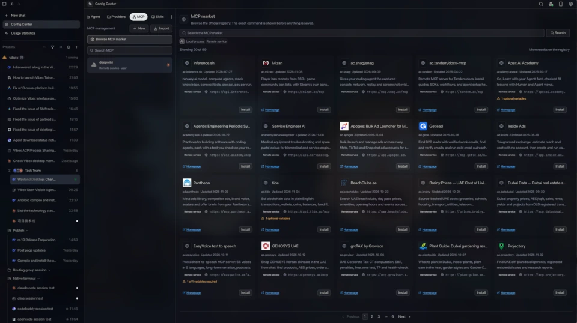
</td>
</tr>
</table>

**Also in the box:**

- **[Global search and command palette](https://vibex.peatboy.com/docs/reference/shortcuts#search-entry-points)** — one search across sessions, settings, and quick actions.
- **[Usage statistics](https://vibex.peatboy.com/docs/usage)** — tokens and cost by Agent, project, provider, model, and time range.
- **[Notifications and unread state](https://vibex.peatboy.com/docs/sessions#notifications-and-unread-state)** — know when an Agent finishes, fails, or needs input.
- **[Session archive](https://vibex.peatboy.com/docs/sessions)** — keep finished work out of the sidebar without losing its timeline.
- **[Auto-updates](https://vibex.peatboy.com/docs/install#upgrade)** — on by default, verified against a signed release manifest.
- **[Themes and workbench backgrounds](https://vibex.peatboy.com/docs/settings#appearance)** — twenty built-in themes, custom JSON themes, and still or animated backgrounds.
- **And more shipping every week** — the [changelog](https://github.com/vibex-ai/vibex/releases).

---

## Supported Agents

Vibex uses the [Agent Client Protocol](https://agentclientprotocol.com/) (ACP) as the online Agent transport. An Agent's identity and capabilities stay separate from the protocol used to connect it. Works with **any ACP-compatible agent** — if it speaks ACP, it runs in Vibex. Agents that ship their own TUI can also run in their native terminal mode directly inside Vibex.

<div align="center">
  <table>
    <tr>
      <td align="center" valign="middle" width="135" height="84">
        <a href="https://docs.anthropic.com/en/docs/claude-code">
          <br />
          <sub><b>Claude Code</b></sub>
        </a>
      </td>
      <td align="center" valign="middle" width="135" height="84">
        <a href="https://github.com/openai/codex">
          <br />
          <sub><b>Codex</b></sub>
        </a>
      </td>
      <td align="center" valign="middle" width="135" height="84">
        <a href="https://z.ai">
          <br />
          <sub><b>ZCode</b></sub>
        </a>
      </td>
      <td align="center" valign="middle" width="135" height="84">
        <a href="https://opencode.ai">
          <br />
          <sub><b>OpenCode</b></sub>
        </a>
      </td>
      <td align="center" valign="middle" width="135" height="84">
        <a href="https://antigravity.google/docs/ide/extensions">
          <br />
          <sub><b>Antigravity</b></sub>
        </a>
      </td>
      <td align="center" valign="middle" width="135" height="84">
        <a href="https://cline.bot/cli">
          <br />
          <sub><b>Cline</b></sub>
        </a>
      </td>
    </tr>
    <tr>
      <td align="center" valign="middle" width="135" height="84">
        <a href="https://www.codebuddy.cn/cli/">
          <br />
          <sub><b>Codebuddy</b></sub>
        </a>
      </td>
      <td align="center" valign="middle" width="135" height="84">
        <a href="https://docs.cursor.com/en/cli/overview">
          <br />
          <sub><b>Cursor</b></sub>
        </a>
      </td>
      <td align="center" valign="middle" width="135" height="84">
        <a href="https://geminicli.com">
          <br />
          <sub><b>Gemini CLI</b></sub>
        </a>
      </td>
      <td align="center" valign="middle" width="135" height="84">
        <a href="https://docs.github.com/en/copilot/concepts/agents/about-copilot-cli">
          <br />
          <sub><b>GitHub Copilot</b></sub>
        </a>
      </td>
      <td align="center" valign="middle" width="135" height="84">
        <a href="https://cli.devin.ai/docs">
          <br />
          <sub><b>Devin</b></sub>
        </a>
      </td>
      <td align="center" valign="middle" width="135" height="84">
        <a href="https://docs.x.ai/build/overview">
          <br />
          <sub><b>Grok Build</b></sub>
        </a>
      </td>
    </tr>
    <tr>
      <td align="center" valign="middle" width="135" height="84">
        <a href="https://hermes-agent.nousresearch.com/docs/user-guide/features/acp">
          <br />
          <sub><b>Hermes</b></sub>
        </a>
      </td>
      <td align="center" valign="middle" width="135" height="84">
        <a href="https://github.com/MoonshotAI/kimi-cli">
          <br />
          <sub><b>Kimi Code</b></sub>
        </a>
      </td>
      <td align="center" valign="middle" width="135" height="84">
        <a href="https://github.com/svkozak/pi-acp">
          <br />
          <sub><b>Pi</b></sub>
        </a>
      </td>
      <td align="center" valign="middle" width="135" height="84">
        <a href="https://github.com/vibex-ai/deepseek-harness-acp">
          <br />
          <sub><b>DeepSeek Harness</b></sub>
        </a>
      </td>
      <td align="center" valign="middle" width="135" height="84">
        <a href="https://agentclientprotocol.com">
          <br />
          <sub><b>Any ACP Agent</b></sub>
        </a>
      </td>
      <td align="center" valign="middle" width="135" height="84">
        <sub><b>More agents coming soon</b></sub>
      </td>
    </tr>
  </table>
</div>

Built-in presets include **Claude Code**, **Codex**, **ZCode**, and **OpenCode**. The ACP catalog also includes **Antigravity**, **Cline**, **Codebuddy**, **Cursor**, **Gemini CLI**, **GitHub Copilot**, **Devin**, **Grok Build**, **Hermes**, **Kimi Code**, **Pi**, **DeepSeek Harness**, and more. Availability is checked against the installed runtime, provider configuration, and live capability probes.

You can also register any ACP-compatible executable with its command, arguments, environment, and display metadata. Adding an Agent does not require a new UI or a second vendor-specific session protocol.

---

## Surfaces

| Surface | Role | Entry point |
| --- | --- | --- |
| **Desktop** | Full native GPUI workbench and the authoritative `DesktopRuntime` for Agents, workspaces, files, Git, PTYs, browser, computer use, providers, permissions, and durable state. | Linux, macOS, and Windows; [download the latest release](https://github.com/vibex-ai/vibex/releases/latest). |
| **Mobile** | Native GPUI iOS and Android companion. Renders the desktop session model as a GUI timeline and sends typed remote mutations. | Android APK and unsigned iOS device IPA from [Releases](https://github.com/vibex-ai/vibex/releases/latest). |
| **TUI** | Character-grid client over the same runtime protocol. Ships inside every desktop package and can attach to a running desktop runtime. | `vibex` / `vibex-tui`, `vibex connect`, or `vibex-server tui`. |
| **Headless runtime** | `vibex-server`: the same authoritative runtime without a window, for a server or always-on machine. | `ghcr.io/vibex-ai/vibex-server` or a release binary. |
| **Relay** | Optional Rust/Axum transport for encrypted WebSocket frames. It stores no workspace, provider, Agent, or application data. | `apps/relay-server` and `deploy/relay`. |

Mobile never starts a local Agent, owns a workspace filesystem, mutates local Git, or becomes a second PTY authority. The TUI is a client too: it renders the runtime's projections and sends typed mutations. Neither client becomes a second backend.

---

## Quick Start

### Install the desktop app

Download the package for your platform from [GitHub Releases](https://github.com/vibex-ai/vibex/releases/latest):

- **Linux:** `.deb`, `.rpm`, or AppImage (x86_64); `.deb` or `.rpm` for aarch64.
- **macOS:** `.dmg` for Apple silicon or Intel.
- **Windows:** NSIS `.exe` for x86_64 or ARM64.

Arch Linux users can install from the AUR instead, which republishes the release
`.deb` with the `vibex` and `vibex-tui` commands on `PATH`:

```bash
yay -S vibex-bin     # or: paru -S vibex-bin
```

macOS and Windows packages are currently unsigned, so the first launch needs Gatekeeper or SmartScreen approval. See [Install](https://vibex.peatboy.com/docs/install) for the exact steps.

### First session

1. Open **Config Center → Agents**, add an Agent, and install its managed runtime if Vibex offers one.
2. Sign in to the Agent's own account, or add a model Provider profile with an API key.
3. Open a project folder, start a session, and send a task.
4. Review the plan, tool calls, and diff; approve or deny permission requests as they arrive.

### Try the terminal client

The TUI ships with the desktop package and works from a terminal straight after
install:

```bash
cd /path/to/your/project
vibex          # or vibex-tui; both names are the same client
```

It serves the channel it was installed as — the RC package opens `desktop-rc`,
the stable package `desktop-stable` — so nothing has to be exported first. Use
`vibex --channel stable` to serve another channel for one run. It attaches to
the runtime for that home, starting one if needed. Run `vibex status` to see
which runtime it would use, or `vibex connect vibex://…` to pair with a remote
runtime. See [Vibex TUI](https://vibex.peatboy.com/docs/tui).

### Build from source

```bash
git clone https://github.com/vibex-ai/vibex.git
cd vibex
git submodule update --init --recursive
pnpm install --frozen-lockfile
pnpm dev:desktop
```

Prerequisites: Git with submodule support, Node.js 22, pnpm 11.3.0, Rust 1.99.1, and a graphical session with a working Vulkan driver.

---

## Architecture

The desktop runtime is the single authority. Shared contracts and projections keep the native desktop, mobile, and TUI behavior aligned without duplicating business state.

```text
DesktopRuntime / vibex-server
|-- ACP Agent sessions and authoritative timelines
|-- Workspace files, editor, Git, and managed worktrees
|-- Native PTYs, embedded browser, computer use, content previews
|-- Shared Providers, route groups, and the local model gateway
`-- Typed RemoteGateway v2
    |-- Direct or Tailnet transport
    `-- Encrypted self-hosted Relay
            -> AutoRemoteTransport
            -> Native mobile GPUI client
            -> Vibex TUI
```

The main ownership boundaries are:

- `crates/core` defines serialized ids, DTOs, errors, capabilities, and remote protocol contracts.
- `crates/desktop-model` owns framework-neutral session and timeline projections and reducers.
- `crates/vibex-backend` exposes provider-neutral capability facades shared by native and remote adapters.
- `crates/vibex-ui` owns semantic tokens, portable component models, workflow controllers, and shell composition.
- `crates/vibex-remote-client` owns pairing, reconnect, synchronization, and Direct, Tailnet, and Relay route selection.
- `apps/desktop` owns the native workbench and `DesktopRuntime`; `apps/mobile` and `apps/tui` compose the shared projections into their own surfaces.

Read the [UI architecture boundary](docs/architecture/ui-boundary.md), [platform support matrix](docs/platform/support-matrix.md), [Remote Protocol v2](docs/remote/protocol-v2.md), and [SSH Remote Runtime](docs/remote/ssh-runtime.md) for the detailed contracts.

---

## Privacy and Control

- **Local-first storage:** session timelines, workspace metadata, provider profiles, browser profiles, and runtime state are owned by the runtime and stored locally.
- **Explicit permissions:** Agent tools, terminal actions, browser navigation, computer use, device access, and remote mutations are capability-gated and auditable.
- **Encrypted remote access:** Direct, Tailnet, and Relay routes use typed handshakes and encrypted transport. Relay forwards frames but cannot decrypt business payloads.
- **Scoped provider configuration:** Vibex does not rewrite real Agent home configuration by default. Export is an explicit user action with preview and rollback boundaries.
- **Redacted diagnostics:** tokens, private keys, prompts, file contents, browser cookies, and terminal bytes are excluded from logs and diagnostic artifacts.

---

## Development

Vibex is a Rust 2024 workspace with a small Node/pnpm toolchain for packaging and release checks.

```bash
pnpm check                 # Rust fmt/clippy/tests, frontend typecheck, licenses
pnpm release:build-smoke   # desktop, mobile, and Relay build graph
pnpm check:mobile-native   # mobile crate and native project contract
```

Use the smallest relevant gate while iterating. Packaging, mobile, Relay, and release instructions live in the [developer guide](https://vibex.peatboy.com/docs/developer) and [docs/operations/release.md](docs/operations/release.md).

---

## Contributing

Thanks to every developer who has helped Vibex. If you run into a problem, open an Issue or a Pull Request.

<a href="https://github.com/vibex-ai/vibex/graphs/contributors">
  
</a>

---

## Thanks

- [Agent Client Protocol](https://agentclientprotocol.com) — Vibex implements its Agent communication on top of ACP.
- [GPUI GPUI-KIT](https://gpui-kit.com/) — the GPUI core and the GPUI-KIT component library render the Vibex desktop and mobile apps.
- [Cua](http://cua.ai/) — Vibex builds computer use on top of Cua.
- [Linux.do](https://linux.do/) — Linux.do gives Vibex a place to spread the word and talk with users.

---

## License

Vibex is free software licensed under the [GNU Affero General Public License v3.0 or later](LICENSE). Third-party package, font, icon, and PDFium notices are recorded in [docs/licenses](docs/licenses/README.md).
