<h1 align="center">
  <a href="https://vibex.peatboy.com/"></a>
</h1>

<p align="center">
  <a href="https://github.com/vibex-ai/vibex"></a>
  <a href="LICENSE"></a>
  
  
  
  
  <a href="https://deepwiki.com/vibex-ai/vibex"></a>
</p>

<p align="center">
  <a href="README.md">English</a> &nbsp;|&nbsp;
  <a href="README.zh-CN.md">简体中文</a>
</p>

<p align="center">
  <strong>你的 Agent，你的工作区，你来掌控——从提示词到提交，从桌面到终端再到手机。</strong><br />
  面向 Agent 驱动软件开发的原生、本地优先 AI 编程工作台，建立在 Agent Client Protocol 之上。
</p>

<p align="center">
  <a href="https://vibex.peatboy.com/">网站</a> &nbsp;&bull;&nbsp;
  <a href="https://vibex.peatboy.com/docs">文档</a> &nbsp;&bull;&nbsp;
  <a href="#快速开始">快速开始</a> &nbsp;&bull;&nbsp;
  <a href="#功能">功能</a> &nbsp;&bull;&nbsp;
  <a href="#支持的-agent">支持的 Agent</a> &nbsp;&bull;&nbsp;
  <a href="#产品形态">产品形态</a> &nbsp;&bull;&nbsp;
  <a href="#开发">开发</a>
</p>

<p align="center">
  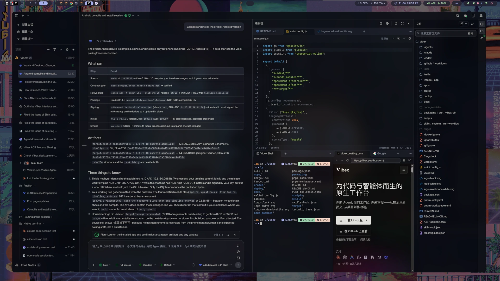
</p>

Vibex 将 Agent 会话、源代码、Git、终端、内嵌浏览器、电脑操作和供应商配置整合到一个专注的工作台中。桌面运行时统一管理 Agent 进程、会话历史、工作区文件、Git、PTY、供应商和权限。原生移动端和终端客户端可以远程监控并操控相同的会话，可选的自托管 Relay 只承载加密帧。

运行 Vibex 无需任何由 Vibex 托管的工作区。你的代码仓库、凭据和持久化会话状态都会保留在你选择的设备上。

## 功能

<table>
<tr>
<td width="50%" valign="middle">

### 所有 Agent，一个工作台

并排运行 Claude Code、Codex、ZCode、OpenCode，以及任何兼容 ACP 的 Agent。Vibex 负责安装、升级、登录和按 Agent 隔离运行时，再把所有会话收进同一条时间线。你可以在 Vibex 中自由使用 GUI 或 TUI 模式创建 Agent 会话。 

[文档 →](https://vibex.peatboy.com/docs/agents-and-providers)

</td>
<td width="50%">
  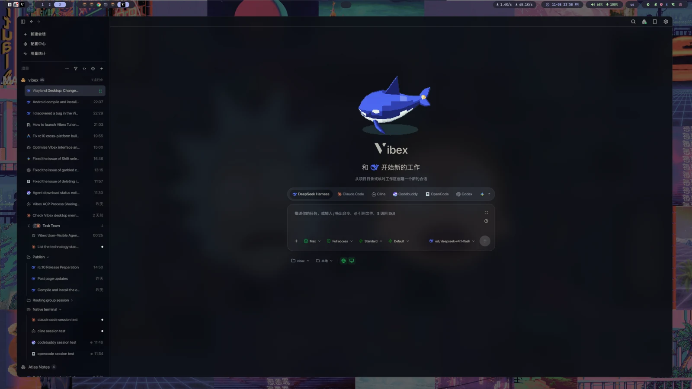<br />
  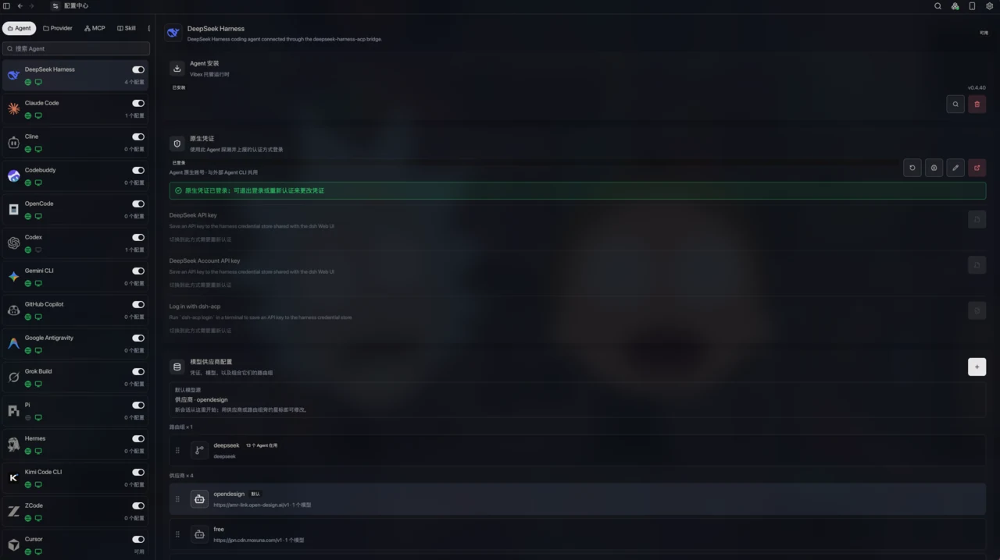
</td>
</tr>
<tr>
<td width="50%" valign="middle">

### Agent 团队与目标

主 Agent 可以自主将任务委派给子 Agent，或在你的引导下在必要时刻委派指定的子 Agent。Vibex 中支持的所有类型的 Agent Harness 都是可选对象，实现跨 Agent 委派。

[文档 →](https://vibex.peatboy.com/docs/sessions)

</td>
<td width="50%">
  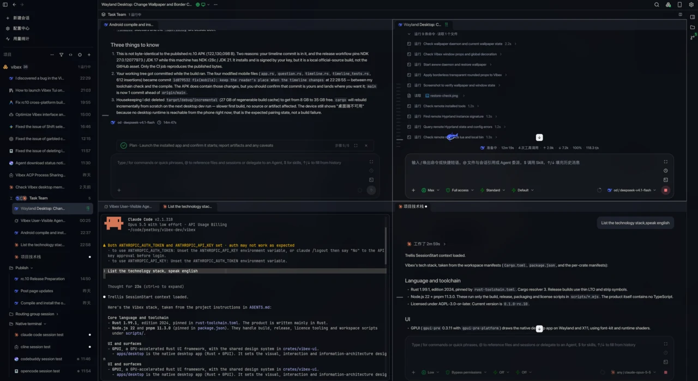
</td>
</tr>
<tr>
<td width="50%" valign="middle">

### 并行 Worktree 与 Git 审查

每一个会话都能拥有自己的 Worktree，并发 Agent 开发时互不影响，Vibex 同时提供常用的 变更 与 提交 管理功能，可以清晰明了的看见实时的 Agent 变更。

[文档 →](https://vibex.peatboy.com/docs/git)

</td>
<td width="50%">
  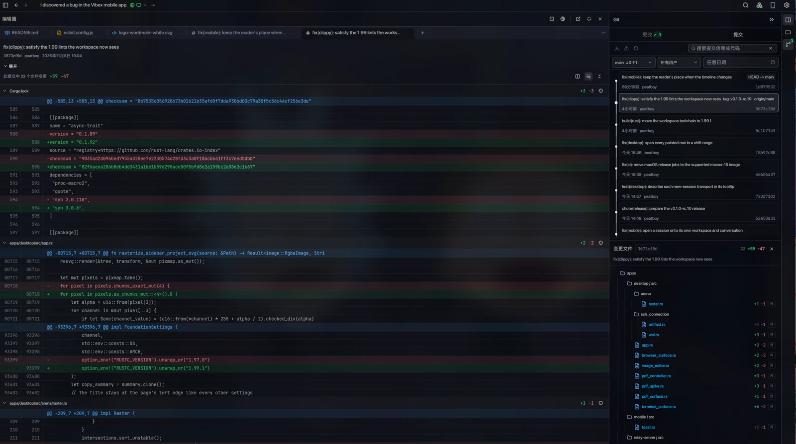
</td>
</tr>
<tr>
<td width="50%" valign="middle">

### 共享供应商与本地网关

模型供应商只需配置一次，就能供多个 Agent 使用。路由组能同时配置多个模型供应商，并在供应商或模型之间故障转移，在 OpenAI Chat、OpenAI Responses、Anthropic Messages 与 Gemini 之间转换协议，实现只支持自有协议的 Agent 也能同时接入其他协议的模型。

[文档 →](https://vibex.peatboy.com/docs/providers-and-gateway)

</td>
<td width="50%">
  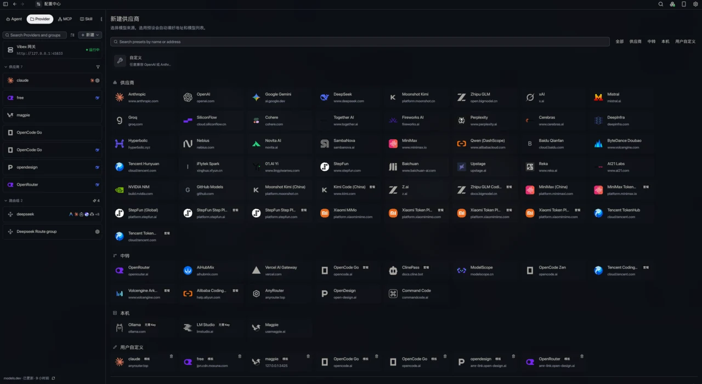<br />
  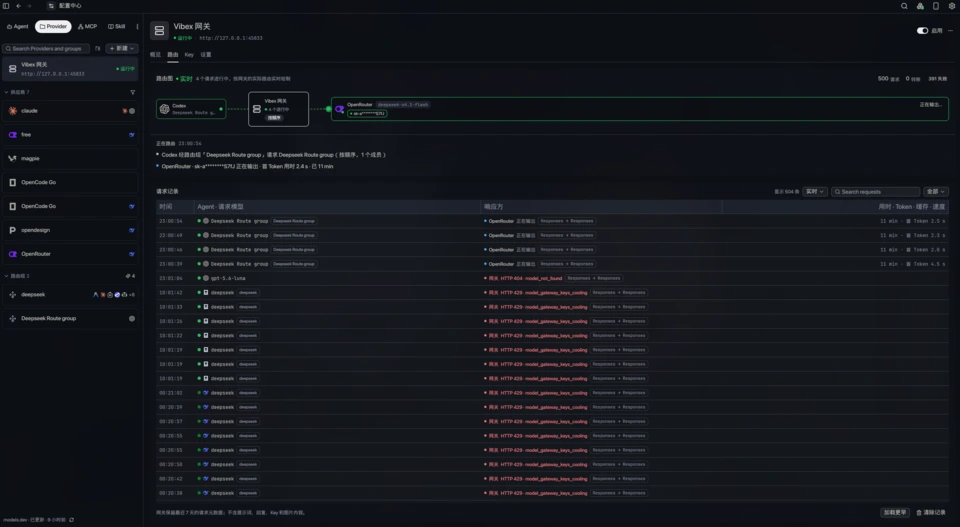
</td>
</tr>
<tr>
<td width="50%" valign="middle">

### 终端、浏览器与电脑操作

Vibex 中的编辑器中可以同时打开文件，终端，浏览器进行阅读与编辑，Agent 也可以操作 Vibex 中的浏览器浏览网页，同时也支持通过电脑操作控制电脑——你可以从专用面板观看、批准并随时停止。

[文档 →](https://vibex.peatboy.com/docs/browser)

</td>
<td width="50%">
  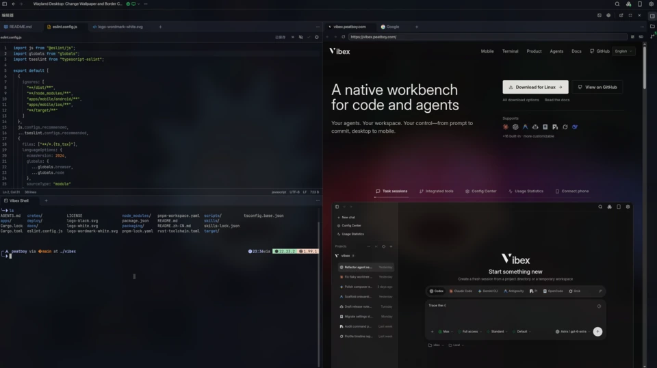
</td>
</tr>
<tr>
<td width="50%" valign="middle">

### 手机，同一个会话

将 Android 或 iOS 客户端（未上架商店）与桌面或远程实例配对。查看同一条时间线、处理审批与提问、发送后续消息、浏览文件和差异，并使用终端——随时随地 Vibe coding。

[文档 →](https://vibex.peatboy.com/docs/remote-mobile)

</td>
<td width="50%">
  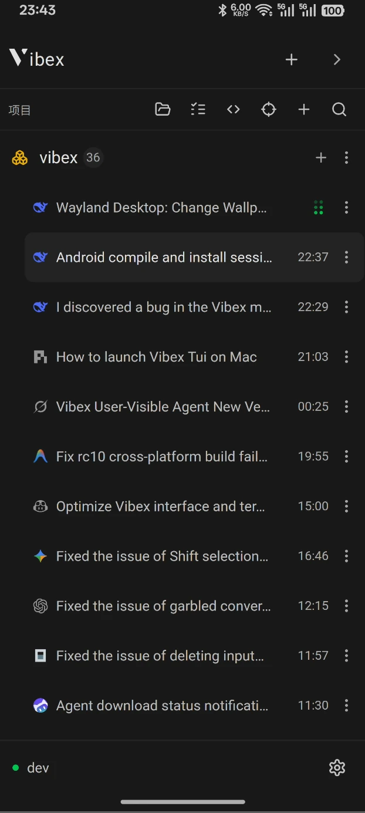 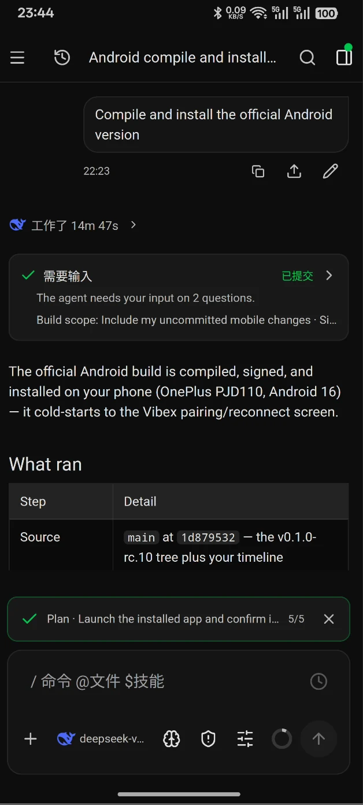 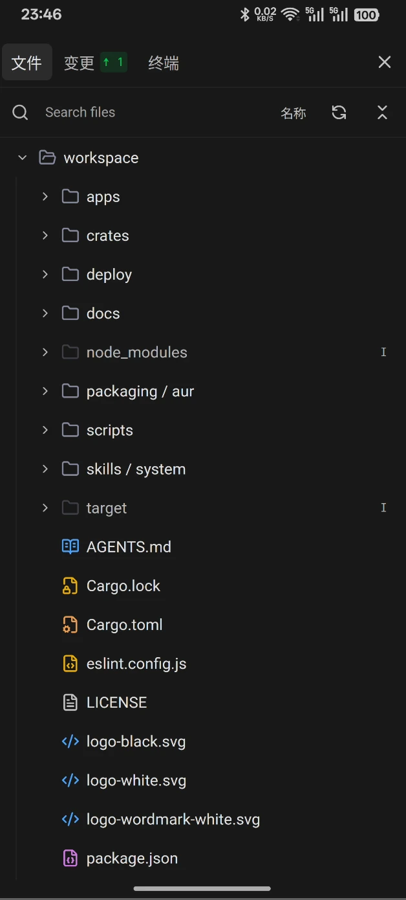
</td>
</tr>
<tr>
<td width="50%" valign="middle">

### Vibex TUI

把整个工作台装进终端：会话、流式 Markdown、审批、队列、设置与配对。它随每个桌面安装包一起发布，支持 SSH 和 tmux，也能附着到本机正在运行的桌面运行时。

[文档 →](https://vibex.peatboy.com/docs/tui)

</td>
<td width="50%">
  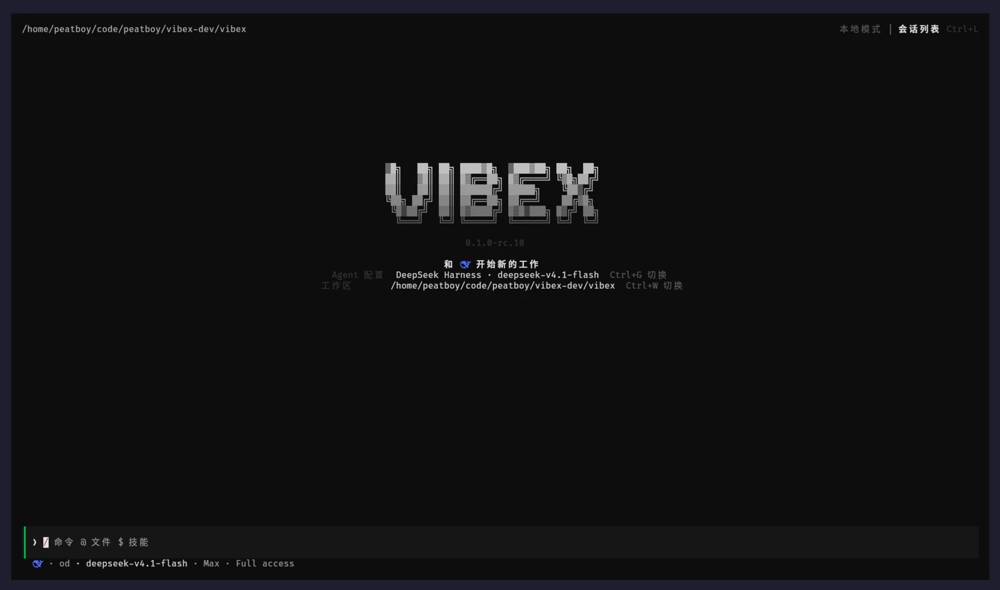<br />
  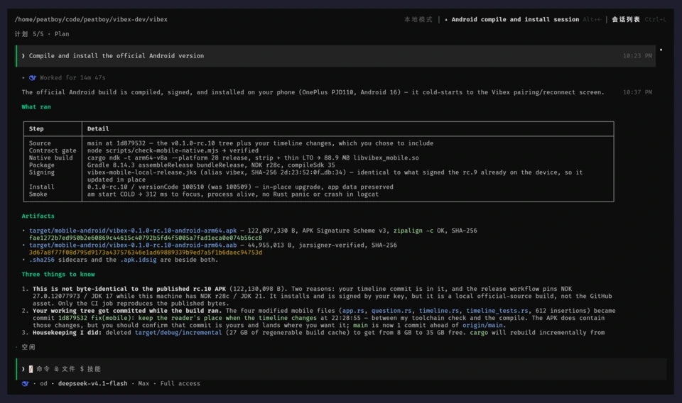
</td>
</tr>
<tr>
<td width="50%" valign="middle">

### 远程运行时，由你决定

通过 SSH 或 WSL2 在另一台机器上运行 Vibex 远程实例，或把 `vibex-server` 自托管在 HTTPS、Tailnet 或自己的 Relay 后面。桌面端、手机和 TUI 始终是客户端；远程实例服务一切。

[文档 →](https://vibex.peatboy.com/docs/ssh-runtime)

</td>
<td width="50%">
  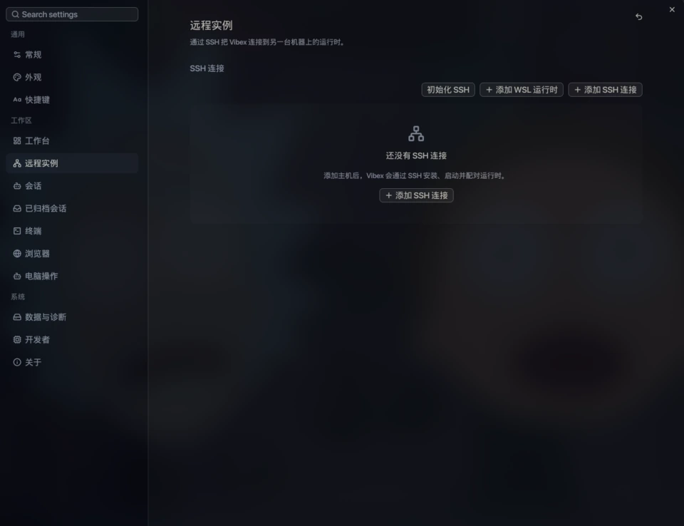
</td>
</tr>
<tr>
<td width="50%" valign="middle">

### 市场、上下文与预览

从应用内市场安装 MCP 服务器和 Skill，编写可复用 Prompt，并按 Agent 限定每项资源。在工作台里阅读 Markdown、PDF、Office 文档和图片，支持分栏、全屏预览，以及属于你的工作台背景。

[文档 →](https://vibex.peatboy.com/docs/mcp-and-skills)

</td>
<td width="50%">
  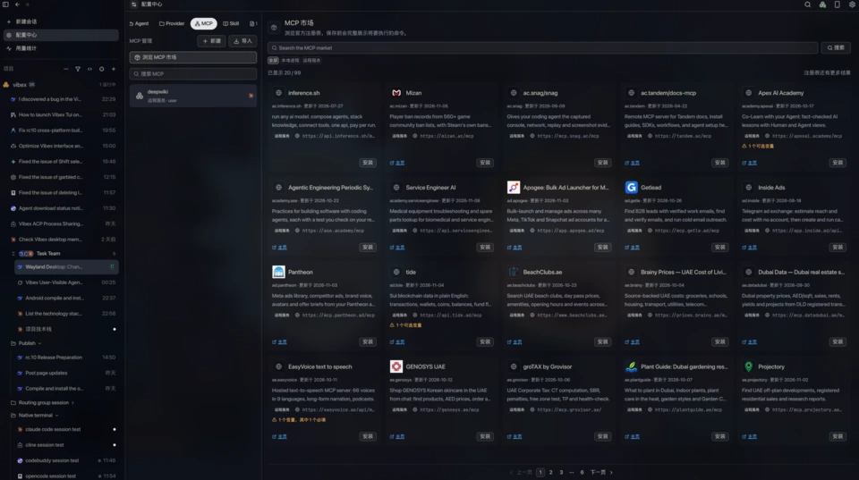
</td>
</tr>
</table>

**另外还内置了：**

- **[全局搜索与命令面板](https://vibex.peatboy.com/docs/reference/shortcuts#搜索入口一览)** —— 一次搜索会话、设置和快捷操作。
- **[用量统计](https://vibex.peatboy.com/docs/usage)** —— 按 Agent、项目、供应商、模型和时间范围查看 token 与成本。
- **[通知与未读状态](https://vibex.peatboy.com/docs/sessions#通知与未读)** —— Agent 完成、失败或需要输入时及时知道。
- **[会话归档](https://vibex.peatboy.com/docs/sessions)** —— 把完成的工作移出侧栏，同时保留完整时间线。
- **[自动更新](https://vibex.peatboy.com/docs/install#升级)** —— 默认开启，更新清单经过签名校验。
- **[主题与工作台背景](https://vibex.peatboy.com/docs/settings#外观)** —— 二十套内置主题、自定义 JSON 主题，以及静态或动态背景。
- **还有更多，每周都在发布** —— [更新日志](https://github.com/vibex-ai/vibex/releases)。

---

## 支持的 Agent

Vibex 使用 [Agent Client Protocol](https://agentclientprotocol.com/)（ACP）作为在线 Agent 传输协议。Agent 的身份和能力与连接它所使用的协议彼此分离。兼容 **任何 ACP Agent**——只要说 ACP，就能在 Vibex 中运行。另外部分拥有 TUI 的 Agent，也支持在 Vibex 中直接使用它的原生终端模式。

<div align="center">
  <table>
    <tr>
      <td align="center" valign="middle" width="135" height="84">
        <a href="https://docs.anthropic.com/en/docs/claude-code">
          <br />
          <sub><b>Claude Code</b></sub>
        </a>
      </td>
      <td align="center" valign="middle" width="135" height="84">
        <a href="https://github.com/openai/codex">
          <br />
          <sub><b>Codex</b></sub>
        </a>
      </td>
      <td align="center" valign="middle" width="135" height="84">
        <a href="https://z.ai">
          <br />
          <sub><b>ZCode</b></sub>
        </a>
      </td>
      <td align="center" valign="middle" width="135" height="84">
        <a href="https://opencode.ai">
          <br />
          <sub><b>OpenCode</b></sub>
        </a>
      </td>
      <td align="center" valign="middle" width="135" height="84">
        <a href="https://antigravity.google/docs/ide/extensions">
          <br />
          <sub><b>Antigravity</b></sub>
        </a>
      </td>
      <td align="center" valign="middle" width="135" height="84">
        <a href="https://cline.bot/cli">
          <br />
          <sub><b>Cline</b></sub>
        </a>
      </td>
    </tr>
    <tr>
      <td align="center" valign="middle" width="135" height="84">
        <a href="https://www.codebuddy.cn/cli/">
          <br />
          <sub><b>Codebuddy</b></sub>
        </a>
      </td>
      <td align="center" valign="middle" width="135" height="84">
        <a href="https://docs.cursor.com/en/cli/overview">
          <br />
          <sub><b>Cursor</b></sub>
        </a>
      </td>
      <td align="center" valign="middle" width="135" height="84">
        <a href="https://geminicli.com">
          <br />
          <sub><b>Gemini CLI</b></sub>
        </a>
      </td>
      <td align="center" valign="middle" width="135" height="84">
        <a href="https://docs.github.com/en/copilot/concepts/agents/about-copilot-cli">
          <br />
          <sub><b>GitHub Copilot</b></sub>
        </a>
      </td>
      <td align="center" valign="middle" width="135" height="84">
        <a href="https://cli.devin.ai/docs">
          <br />
          <sub><b>Devin</b></sub>
        </a>
      </td>
      <td align="center" valign="middle" width="135" height="84">
        <a href="https://docs.x.ai/build/overview">
          <br />
          <sub><b>Grok Build</b></sub>
        </a>
      </td>
    </tr>
    <tr>
      <td align="center" valign="middle" width="135" height="84">
        <a href="https://hermes-agent.nousresearch.com/docs/user-guide/features/acp">
          <br />
          <sub><b>Hermes</b></sub>
        </a>
      </td>
      <td align="center" valign="middle" width="135" height="84">
        <a href="https://github.com/MoonshotAI/kimi-cli">
          <br />
          <sub><b>Kimi Code</b></sub>
        </a>
      </td>
      <td align="center" valign="middle" width="135" height="84">
        <a href="https://github.com/svkozak/pi-acp">
          <br />
          <sub><b>Pi</b></sub>
        </a>
      </td>
      <td align="center" valign="middle" width="135" height="84">
        <a href="https://github.com/vibex-ai/deepseek-harness-acp">
          <br />
          <sub><b>DeepSeek Harness</b></sub>
        </a>
      </td>
      <td align="center" valign="middle" width="135" height="84">
        <a href="https://agentclientprotocol.com">
          <br />
          <sub><b>任意 ACP Agent</b></sub>
        </a>
      </td>
      <td align="center" valign="middle" width="135" height="84">
        <sub><b>更多 Agent 待添加</b></sub>
      </td>
    </tr>
  </table>
</div>

内置预设包括 **Claude Code**、**Codex**、**ZCode** 和 **OpenCode**。ACP 目录还包含 **Antigravity**、**Cline**、**Codebuddy**、**Cursor**、**Gemini CLI**、**GitHub Copilot**、**Devin**、**Grok Build**、**Hermes**、**Kimi Code**、**Pi**、**DeepSeek Harness** 等集成。Vibex 会根据本机已安装的运行时、供应商配置和实时能力探测结果判断可用性。

你也可以注册任意兼容 ACP 的可执行程序，配置其命令、参数、环境变量和显示元数据。新增 Agent 无需修改 UI，也无需再实现一套厂商专用的会话协议。

---

## 产品形态

| 产品形态 | 作用 | 入口 |
| --- | --- | --- |
| **桌面端** | 完整的原生 GPUI 工作台，也是 Agent、工作区、文件、Git、PTY、浏览器、电脑操作、供应商、权限和持久化状态的权威 `DesktopRuntime`。 | 支持 Linux、macOS 和 Windows；[下载最新版本](https://github.com/vibex-ai/vibex/releases/latest)。 |
| **移动端** | 原生 GPUI iOS 和 Android 伴侣应用。将桌面会话模型渲染为 GUI 时间线，并发送类型化远程变更。 | 从 [Releases](https://github.com/vibex-ai/vibex/releases/latest) 获取 Android APK 和未签名 iOS 真机 IPA。 |
| **TUI** | 基于同一套运行时协议的字符网格客户端。随每个桌面安装包发布，也能附着到正在运行的桌面运行时。 | `vibex` / `vibex-tui`、`vibex connect` 或 `vibex-server tui`。 |
| **无头运行时** | `vibex-server`：没有窗口的同一套权威运行时，适合服务器或常开机器。 | `ghcr.io/vibex-ai/vibex-server` 或发布二进制。 |
| **Relay** | 可选的 Rust/Axum 加密 WebSocket 帧传输服务，不存储工作区、供应商、Agent 或应用数据。 | `apps/relay-server` 和 `deploy/relay`。 |

移动端不会启动本地 Agent，不拥有工作区文件系统，不修改本地 Git，也不会成为第二个 PTY 权威。TUI 同样只是客户端：它渲染运行时的投影并发送类型化变更。两者都不会成为第二个后端。

---

## 快速开始

### 安装桌面端

从 [GitHub Releases](https://github.com/vibex-ai/vibex/releases/latest) 下载与你平台匹配的安装包：

- **Linux：** x86_64 使用 `.deb`、`.rpm` 或 AppImage；aarch64 使用 `.deb` 或 `.rpm`。
- **macOS：** Apple 芯片或 Intel 使用 `.dmg`。
- **Windows：** x86_64 或 ARM64 使用 NSIS `.exe`。

Arch Linux 用户也可以直接从 AUR 安装：该包由正式版的 `.deb` 重新打包，并把 `vibex` 与 `vibex-tui` 命令放进 `PATH`。

```bash
yay -S vibex-bin     # 或：paru -S vibex-bin
```

macOS 和 Windows 安装包目前没有代码签名，首次打开需要 Gatekeeper 或 SmartScreen 放行。具体步骤见[安装](https://vibex.peatboy.com/docs/install)。

### 第一次会话

1. 打开 **配置中心 → Agent**，添加一个 Agent；如果 Vibex 提供托管运行时，就安装它。
2. 登录 Agent 自己的账号，或添加一套带 API Key 的模型供应商配置。
3. 打开一个项目目录，新建会话并发送任务。
4. 检查计划、工具调用和差异；权限请求到达时逐项批准或拒绝。

### 试试终端客户端

TUI 随桌面安装包一起发布，装完即可在终端里使用：

```bash
cd /path/to/your/project
vibex          # 或 vibex-tui，两个名字是同一个客户端
```

它服务于所安装的那个 channel（RC 包打开 `desktop-rc`，正式版打开 `desktop-stable`），无需设置任何环境变量；要临时换一个 channel，用 `vibex --channel stable`。它会附着到该 home 对应的运行时，必要时自己启动一个。运行 `vibex status` 可以查看它会使用哪个运行时；运行 `vibex connect vibex://…` 可以配对远程运行时。详见 [Vibex TUI](https://vibex.peatboy.com/docs/tui)。

### 从源码构建

```bash
git clone https://github.com/vibex-ai/vibex.git
cd vibex
git submodule update --init --recursive
pnpm install --frozen-lockfile
pnpm dev:desktop
```

前置条件：支持子模块的 Git、Node.js 22、pnpm 11.3.0、Rust 1.99.1，以及带可用 Vulkan 驱动的图形会话。

---

## 架构

桌面运行时是唯一的权威状态所有者。共享契约和投影让原生桌面端、移动端和 TUI 保持一致，同时避免重复业务状态。

```text
DesktopRuntime / vibex-server
|-- ACP Agent 会话与权威时间线
|-- 工作区文件、编辑器、Git 与托管 worktree
|-- 原生 PTY、内嵌浏览器、电脑操作、内容预览
|-- 共享供应商、路由组与本地模型网关
`-- 类型化 RemoteGateway v2
    |-- Direct 或 Tailnet 传输
    `-- 加密的自托管 Relay
            -> AutoRemoteTransport
            -> 原生移动端 GPUI 客户端
            -> Vibex TUI
```

主要的所有权边界如下：

- `crates/core` 定义序列化 id、DTO、错误、能力以及远程协议契约。
- `crates/desktop-model` 负责与框架无关的会话和时间线投影及 reducer。
- `crates/vibex-backend` 提供原生适配器与远程适配器共享的、与供应商无关的能力 facade。
- `crates/vibex-ui` 负责语义化 token、可移植组件模型、工作流控制器和 shell 组合。
- `crates/vibex-remote-client` 负责配对、重连、同步以及 Direct、Tailnet 和 Relay 路由选择。
- `apps/desktop` 负责原生工作台和 `DesktopRuntime`；`apps/mobile` 与 `apps/tui` 只把共享投影组合成各自的界面。

详细契约请阅读 [UI 架构边界](docs/architecture/ui-boundary.md)、[平台支持矩阵](docs/platform/support-matrix.md)、[Remote Protocol v2](docs/remote/protocol-v2.md)、[SSH Remote Runtime](docs/remote/ssh-runtime.md)，以及 [IM 聊天频道](docs/im-channels.md)。

---

## 隐私与控制

- **本地优先存储：** 会话时间线、工作区元数据、供应商配置、浏览器配置和运行时状态由运行时持有并存储在本地。
- **明确的权限控制：** Agent 工具、终端操作、浏览器导航、电脑操作、设备访问和远程变更都经过能力门控并可审计。
- **加密远程访问：** Direct、Tailnet 和 Relay 路由都使用类型化握手与加密传输。Relay 只转发帧，无法解密业务载荷。
- **有作用域的供应商配置：** 默认情况下 Vibex 不会改写真实 Agent home 配置。导出操作需要用户明确触发，并提供预览和回滚边界。
- **脱敏诊断：** token、私钥、提示词、文件内容、浏览器 Cookie 和终端字节不会写入日志和诊断产物。

---

## 开发

Vibex 是一个 Rust 2024 workspace，只用一小套 Node/pnpm 工具处理打包和发布检查。

```bash
pnpm check                 # Rust fmt/clippy/tests、前端类型检查、许可证
pnpm release:build-smoke   # 桌面端、移动端和 Relay 构建图
pnpm check:mobile-native   # 移动端 crate 与原生项目契约
```

迭代时运行与改动相关的最小检查集。打包、移动端、Relay 和发布说明见[开发者指南](https://vibex.peatboy.com/docs/developer)与 [docs/operations/release.md](docs/operations/release.md)。

---

## 参与贡献
感谢每一位为 Vibex 提供帮助的开发者，使用中存在问题时欢迎提交 Issue 和 Pull Request

<a href="https://github.com/vibex-ai/vibex/graphs/contributors">
  
</a>

---

## 感谢
- [Agent Client Protocol](https://agentclientprotocol.com) — Vibex 基于 ACP 协议实现与各类 Agent 通信
- [GPUI GPUI-KIT](https://gpui-kit.com/) — GPUI 内核与 GPUI-KIT 组件库提供了对 Vibex 桌面端与移动端的渲染
- [Cua](http://cua.ai/) —  Vibex 借助 Cua 实现了电脑操作
- [Linux.do](https://linux.do/) — Linux.do 为 Vibex 提供了宣发与交流的平台

---

## 许可证

Vibex 是自由软件，采用 [GNU Affero General Public License v3.0 或更高版本](LICENSE) 授权。第三方包、字体、图标和 PDFium 的声明记录在 [docs/licenses](docs/licenses/README.md) 中。
